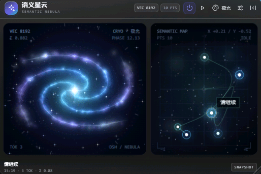

# SemanticNebula

English | [中文](README.md)

`dsh-plugin` · `deepseek-harness` · DSH Web GUI · prompt visualization · canvas2d · nebula · generative art · 语义星云 · 提示词可视化

> I loved the night sky when I was a kid. Years later I spend my days talking to AI models, and one day it occurred to me: why not let every sentence grow one more star up there?
>
> So I built this. It makes nothing faster — it just puts a patch of slowly turning deep space in the corner of DSH.



**SemanticNebula** is a **purely decorative** plugin for the DeepSeek Harness (DSH) Web GUI: each prompt you submit is projected, live, into a draggable four-arm spiral nebula, with a local semantic footprint map beside it.

- It never intercepts or wraps the DSH composer
- It never reads or uploads message content
- No network, no model, no inference calls (the embedding is a local deterministic hash — see *Trade-offs*)
- Client bundle about 160 KB (about 36 KB gzipped), no runtime dependencies

## Install

This repo carries the `dsh-plugin` / `deepseek-harness` topics and declares a `dsh.bundle` manifest in `package.json`, so DSH community marketplaces can pick it up automatically; their install plans read the root `cordis.patch.yml`. For a manual install, follow the three steps below.

DSH discovers plugins through the **profile's pnpm dependencies**, so the package has to become a local dependency of `~/.dsh/profiles/web` first, and then be declared in `cordis.patch.yml`.

> The package is called `dsh-spiral` (the name `dsh-nebula` on npm is taken by an unrelated aurora plugin); the project and product name is still **SemanticNebula**.

```bash
# 1) Grab the source
git clone https://github.com/songzhou666/dsh-spiral.git

# 2) Make the profile aware of the package (local directory, not published to npm)
cd ~/.dsh/profiles/web
pnpm add /path/to/dsh-spiral

# 3) Append the snippet shipped in this repo to ~/.dsh/profiles/web/cordis.patch.yml
- insert:
    - id: dsh-spiral-bundle
      name: dsh-spiral
```

Restart the DSH Web server and a milky-white floating orb appears in the bottom-right corner.

> Note: `dsh plugin --profile web` only does package management. What actually makes the host load the plugin is the `insert` entry in `cordis.patch.yml`. You need both.

## Usage

1. Click the orb in the bottom-right corner to open the **520 × 352** nebula window.
2. Type into the normal DSH composer and hit enter; the window expands and a new semantic point appears.
3. Left side is the **nebula view** (four arms + particles + glow), right side is the **semantic footprint map** (history trail + coordinate grid).
4. Drag the title bar to move the window, drag the bottom-right corner to resize, click "collapse to orb" to minimise.
5. Press play to run a **semantic roam** in submission order; once the model answers, it becomes "roam the answer's semantics".
6. Move the pointer over the nebula and the whole field drifts slightly toward it. The background stars sit at three depths, so the near layer travels furthest while the far layer barely moves — a porthole rather than a flat starfield; stars near the pointer glint.
7. Tap the nebula and a ripple spreads from the hit point, then fades.
8. When collapsed, the orb's glyph and halo take the colour of your latest prompt, and a highlight crawls around the ring once every 7.5 s.
9. Every prompt gets a stable hashed call sign (e.g. `LYRA-7F2`), shown in the nebula HUD, the panel footer, the footprint label and the hover tooltip. The same text always gets the same sign; identity is still the message id.
10. The current prompt owns the main galaxy; the 12 most recent earlier prompts in this session become companion stars around it. Submitting a new one promotes the previous to a fading-in companion, so a long conversation keeps accumulating a halo.
11. When the model finishes an answer, the brightness outline eases from the question's shape to the answer's over 1.8 s, with a `DUAL 54%` readout in the top-right HUD.
12. The download button at the bottom right of the panel exports the current frame as a 1200 x 900 star-chart PNG (prompt, call sign and local readout included). It is generated locally and disabled when there is no semantic point yet.

Atmosphere details (all part of the optional "feel" layer; none of them feed any semantic computation):

- **Breathing** — the whole disc scales ±1.6% on a ~30 s cycle, so a still frame never reads as a wallpaper.
- **Outward beads** — one faint bead per arm drifts outward while riding the pattern, reading as star formation in a density wave; its direction always matches the spin.
- **Inter-arm dust** — the gaps between the arms are not empty: each holds a scatter of fine points whose shear is far softer than the arms (`WIND * 0.34`), so it reads as thin gas co-rotating with the disc rather than as a second density wave. The count follows the embedding-dimension tier (220 / 380 / 560), so a higher setting fills the gaps further, not just the arms.
- **Three star depths** — the 200 background stars are split across three layers with parallax 2.6 / 1.4 / 0.6, decreasing in size and brightness with distance. The layers are interleaved, so every detail tier keeps the same depth mix.
- **Answer echo** — a submission sends an outward shock ring; a completed answer replies with a brightness-only wave sweeping from the outer arms back to the core. It only scales layer alpha: neither `angle` nor any radius changes, so the spin and winding invariants are untouched. Disabled under reduced motion.
- **Meteors** — roughly every 10 s a meteor crosses a corner of the frame: one gradient line plus one sprite.
- **Soft core** — a wide dim halo plus a small nucleus, with the four flares shaped as diamonds that taper to a point; every layer stays under the additive clipping threshold, so the centre reads as one star instead of a hard white disc with a cross. The arms work the same way: several strokes from wide to narrow, each with a radial fade, so no ribbon is ever sheared off flat.
- **Film grain** — a 128² noise tile composited with `overlay`; it adds texture to the dark areas and doubles as dithering against 8-bit banding.

## Session cluster, twin silhouette and star-chart card

All three layers share one constraint: no new capture surface, no network, and no change to `angle`, `WIND` or any radius. The physics regression still measures the same disc as before.

**Session cluster** — the opening promise, "every sentence grows one more star in the sky", is now literal. The current prompt owns the main galaxy; the 12 most recent earlier prompts in the session each become a companion in the halo. Azimuth comes from that point's position on the footprint map (`mapX / mapY`), colour from its own family, magnitude from how recent it is. The brightest few carry a cross-shaped sparkle, and every one sits on a short arc of its orbit rather than a spoke aimed at the core. Companions ride the disc at `angle * 0.8 * 0.86`, slightly slower than the pattern, reading as differential rotation in the outer disc. A new submission is what demotes the previous prompt into a companion, which then fades in over 1.1 s — no extra history is stored, and the top-left HUD shows `CLUSTER n/12`. Under reduced motion the halo is static and skips the fade.

**Twin silhouette** — a completed answer does more than send the inward brightness echo: the answer text goes through `analyze()` once to produce a second 256-band outline, which is smoothstep-interpolated with the question's over 1.8 s. Colours blend across the two families in 16 cached steps (`mixHex` results are memoised, so no hex parsing per frame). The HUD shows `DUAL 54%` and the first line becomes `CRYO/IRIS`. Only `profile`, colour and `magnitude` change; `angle`, winding, radii and perspective are untouched. A new question takes over the interpolation base while the mix unwinds to zero, so the previous galaxy never flashes back. Roaming playback takes priority, and clearing the answer eases back smoothly; reduced motion lands on the final outline without a transition.

**Star-chart card** — the download button frames the current frame as a 1200 x 900 PNG. The canvas is synchronously repainted once at 2.5x DPR and copied into an offscreen canvas, then laid out with the title, call sign, prompt text, `TOK` / `ENERGY` / `MAP` / `VEC` / palette / time, finder-frame corner ticks and a "generated locally" watermark; the filename carries the call sign and a timestamp. Everything is `canvas.toBlob` → local download: no dependency, no request. The field uses a contain fit instead of a crop, so the in-frame HUD typography survives — it was part of that frame to begin with.

## Appearance

The card itself follows DSH's light / dark appearance: surface, ink, hairlines, inputs and selected states all come from the host design tokens (`--dsw-alias-bg-layer-1`, `--dsw-alias-label-primary`, `--dsw-alias-border-l2`, …), so light is white glass, dark is smoked glass, and custom themes are followed as well. The adaptation is pure CSS — the host flips `data-ds-dark-theme` on `<body>` and the plugin reads that attribute; there is no theme subscription and no extra render.

Both canvases stay dark in either appearance: space is always dark outside the porthole, only the frame is repainted. Star colours still come from the palette (Deep space / Aurora / Corona / Silver / Supernova) and are not overridden by the theme. The last two are a near-monochrome silver plate and a gold/red supernova; the first three mappings are unchanged, so switching palettes never repaints existing footprints.

## Rotation and physics

The picture obeys the two basic constraints of a spiral galaxy, and no layer ever counter-rotates:

- **Trailing arms** — `angle` grows monotonically (clockwise on screen) while the arm's `theta` gets *smaller* as it winds out (`WIND = -4`), so the outer end always sits one step of phase behind the inner one: the arm is the wake behind the spin. Flip the sign and the outer tip would cross any given azimuth before the inner part — that is a **leading** arm, an arm outrunning the rotation it belongs to.
- **Rigid pattern, differential material** — the density wave itself rotates rigidly at one angular velocity, while the inner filaments run a little faster (`angle * 1.12`) and the outer motes a little slower (`angle * 0.25`): differential rotation, without winding the arms ever tighter.

Why trailing and not leading: nearly every real spiral (M51, M101, …) trails. The classic argument is simple — differential rotation, fast inside and slow outside, shears a radial spoke into a curve with exactly one handedness, the trailing one; leading arms need an external disturbance and are the exception (NGC 4622 is the famous one). So trailing is both the physical answer and the one that reads like a galaxy.

Earlier the `iris` / `ember` families flipped direction by `scheme.id`, pairing counter-clockwise spin with clockwise arms, and the angular velocity would jump whenever a roam crossed a frame (`mix` past 0.5) or the palette changed. Now `angle` is the single source of angular velocity: it accumulates monotonically, frame after frame, independent of the current palette. The handedness is no longer a `t * 4` scattered through the draw loop either — it lives in one constant, `WIND`, and the physics regression asserts its sign.

Every bright point leaves a short **motion trail** along its orbit (`theta − 0.022`), so the trailing direction is readable without the HUD. With Motion set to *Follow system* and the platform asking for less, the trails, parallax, breathing, meteors, beads and ripples are all disabled and the grain is skipped — the disc keeps a slow ~1°/s turn instead of freezing into a still image that reads as a broken plugin.

The atmosphere layers are deliberately capped at "a few extra draws per frame": grain is one pattern fill, a meteor is one gradient line, a ripple is two arcs, the beads are four sprites. Measured on a 520 × 352 canvas at DPR 2 it still holds 60 fps.

## Settings

The gear in the window's top-right corner opens settings:

| Setting | Meaning |
| --- | --- |
| Enable prompt visualisation | Master switch; turning it off goes dormant immediately and stops capturing submissions |
| Auto-open on submit | Fires once for a new submission in the current session |
| Keep semantic footprint | Writes to this machine's `localStorage`, visible only on this device |
| Embedding dimensions | 8192 standard / 16384 fine / 32768 maximum (only changes how much detail is drawn, including the fill between the arms; never the geometry) |
| Palette | Deep space / Aurora / Corona / Silver / Supernova |
| Motion | Always full (default) / Follow system |
| Speed | Low / Medium (default) / High |

Clearing history needs two clicks.

### The disc is not turning

### Too fast, too slow

The spin is set in ⚙ settings → **Speed**, three tiers, *Medium* by default:

| Tier | Roughly | One turn |
| --- | --- | --- |
| Low | 2.5°/s | about 140 s |
| Medium | 5°/s | about 70 s |
| High | 9.5°/s | about 37 s |

It only changes the spin and the arms' advance, never the shape. Moving the pointer adds a little speed and a parallax shift, so measurements drift a bit around the nominal value.

### Quieter picture

The default is *Always full*. For less motion, set ⚙ settings → **Motion** → *Follow system*: when the system asks for reduced motion (Windows: Settings → Accessibility → Visual effects → Animation effects), the panel drops to a ~1°/s drift and switches off parallax, trails, meteors, ripples and grain.

The other way round works too: if the system asks for less motion but you want the full spin, choose *Always full* — no system change, no restart.

The play button replays a semantic roam; it does not start the rotation.

## Privacy and data

- The only capture points are **submissions**: `SessionSnapshot.pendingSubmissions` and the `user/message` event.
- No `onInput` hook, no composer scraping, no streaming-token processing.
- Persistence stores only: the prompt text, its timestamp, and a locally generated 256-band quantised profile.
- Everything is computed in the browser. There are no network requests at all.
- Card export only paints already-captured prompts and local results into a PNG downloaded by the browser. Nothing is uploaded or written to a server.

## Architecture

```
src/
  index.ts              Host side: no side effects
  client/
    index.ts            Client entry: mounts the body-level overlay
    controller.ts       Submission capture / session binding / visibility state machine
    store.ts            Point store, dedupe, localStorage persistence
    engine.ts           Local deterministic embedding, sequence frames, companion orbits
    motion.ts           Motion policy (full / follow system) and speed tiers
    canvas.ts           Drawing helpers, colour blending, high-DPR capture event
    exportCard.ts       Offline star-chart layout and PNG export
    Panel.tsx           Window content (both views + settings)
    NebulaCanvas.tsx    Left nebula (additive blending, session cluster, twin silhouette)
    NebulaMap.tsx       Right semantic map
    Floating.tsx        Drag / resize / collapse to orb
    styles.ts           Milky-glass styling
scripts/
  build.mjs             esbuild bundle (CJS → lib/client.js)
  test-engine.mjs       Embedding invariants
  test-controller.mjs   Controller state machine
  test-companions.mjs   Companion orbits / colour blending / morph premises
  verify-physics.mjs    Offline physics regression: mounts the real component on a blank page and measures the painted image
```

## Development

```bash
pnpm install
pnpm build          # builds lib/index.js and lib/client.js
pnpm watch          # incremental build
pnpm test           # embedding + controller + companion/morph invariants
```

For local debugging, `dev.patch.yml` points the host straight at the build output — no install needed (set its `name` to the absolute path of `lib/index.js` on your machine first):

```bash
dsh web --patch /path/to/dsh-spiral/dev.patch.yml --port 3081 --host 127.0.0.1 --no-open
```

The visual regression scripts need a local Playwright Chromium (`pnpm add -D playwright && npx playwright install chromium`; if Playwright lives elsewhere, point `PLAYWRIGHT_MODULE` / `CHROMIUM_PATH` at it):

```bash
node scripts/verify-answer.mjs 'http://127.0.0.1:3081/?token=…'    # answer-roam path
node scripts/verify-render.mjs 'http://127.0.0.1:3081/?token=…'    # panel render + arm count
node scripts/verify-hmr.mjs    'http://127.0.0.1:3081/?token=…'    # does the host pick up a rebuilt bundle
```

You can also ask the running server which build it is actually serving, without a browser (`/plugins/events` broadcasts the plugin graph):

```bash
node scripts/check-live-bundle.mjs 'http://127.0.0.1:3080'
```

Spin direction and arm winding are hard constraints for this decoration. After changing any angle coefficient or draw order, run the offline physics regression — no token, no server (it mounts the real component on a blank page and measures the motion back out of the pixels):

```bash
pnpm verify        # spin direction / arm trailing / pointer parallax / frame budget
node scripts/verify-physics.mjs --reduced               # still turning under reduced motion
node scripts/verify-physics.mjs --reduced --motion=full  # the setting overrides the preference
node scripts/verify-physics.mjs --speed=low              # low tier, measured
node scripts/verify-physics.mjs --speed=high             # high tier, measured
```

It measures angular velocity with a cyclic cross-correlation of full-turn angular histograms, measures arm winding by the slope of the 4th angular harmonic's phase versus radius, and asserts the two agree (otherwise the arms would read as opening against the wind). It then samples the frame rate to confirm the atmosphere layers stay inside the budget. The report and screenshot land in `.shots/physics-report.json` and `.shots/physics-nebula.png`.

## Trade-offs

The original plan — a `bge-small-zh-v1.5-int8.onnx` local embedding plus a precomputed UMAP terrain — was simplified in this delivery to a **deterministic local hash embedding** with **fixed projection geometry**. No model file is loaded, so semantic fidelity is modest, but the cost is zero network, zero model overhead and about 160 KB (about 36 KB gzipped). If you later want stronger semantic grouping, replace `analyze()` in `engine.ts`; the view layer needs no changes.

## License

[MIT](LICENSE)
