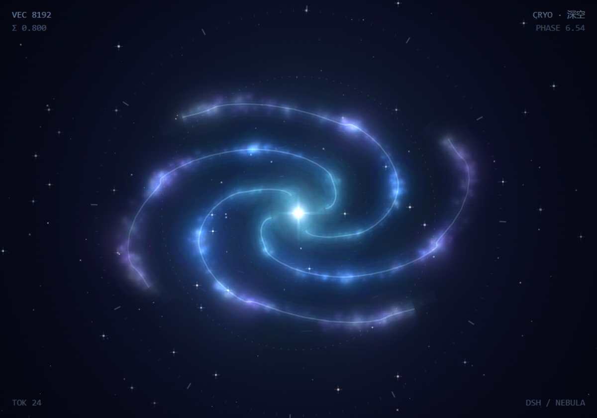

# SemanticNebula · 语义星云

[English](README.en.md) | 中文

> 小时候我很喜欢星空。后来每天都在跟 AI 说话，忽然想：不如让每句话，在天上多长出一颗星。
>
> 于是有了这个插件。它不提高任何效率——只是让 DSH 的角落里，有一片会自己转的深空。



一个 **纯装饰性** 的 DSH Web GUI 插件：把你在输入框里提交的提示词，实时投影成一片可以拖动的深空星云，并在旁边绘制一张本地语义足迹图。

- 不拦截、不包装 DSH 的输入框
- 不读取、不上传任何消息内容
- 不联网、不调用任何模型（嵌入是本机确定性哈希，见「已知取舍」）
- 客户端产物 < 130 KB，无运行时依赖

## 安装

DSH 通过 **profile 的 pnpm 依赖** 发现插件，所以插件包必须先成为 `~/.dsh/profiles/web` 的本地依赖，再在 `cordis.patch.yml` 中声明。

> 包名是 `dsh-spiral`（npm 上的 `dsh-nebula` 已被另一个同名极光插件占用），项目/产品名仍然叫 **SemanticNebula · 语义星云**。

```bash
# 1) 取回源码
git clone https://github.com/songzhou666/dsh-spiral.git

# 2) 让 profile 认识这个包（本地目录，不发布到 npm）
cd ~/.dsh/profiles/web
pnpm add /path/to/dsh-spiral

# 3) 在 ~/.dsh/profiles/web/cordis.patch.yml 末尾追加仓库自带的片段
- insert:
    - id: dsh-spiral-bundle
      name: dsh-spiral
```

重启 DSH Web 服务后，右下角会出现一枚乳白色悬浮球。

> 说明：`dsh plugin --profile web` 只负责包管理；真正让宿主加载插件的是 `cordis.patch.yml` 里的 `insert` 条目。两者缺一不可。

## 使用

1. 点击右下角悬浮球，展开 **520 × 352** 的语义星云窗口。
2. 在 DSH 输入框正常输入并回车；窗口会随之展开并出现新的语义点。
3. 左侧是 **星云视图**（四臂螺旋 + 粒子 + 光晕），右侧是 **语义足迹图**（历史轨迹 + 坐标网格）。
4. 拖动标题栏移动窗口，拖动右下角缩放，点击「收起为悬浮球」最小化。
5. 点击播放按钮，按提交顺序做一次 **语义漫游**；模型回答完成后，会切换为「播放回答语义漫游」。
6. 鼠标在星云上移动时，整片场会朝指针方向轻微平移（星点位移更大），像隔着舷窗观察；靠近指针的星点会微微发亮。
7. 在星云上轻点一下，会从落点荡开一圈涟漪，随即散去。
8. 收起后，悬浮球的图标与光环会染上最近一条提示词的语义色，并有一道高光极缓慢地绕环一周。

氛围细节（都属于可选的「感觉」层，不参与任何语义计算）：

- **呼吸**：整个星盘以约 30 秒的周期做 ±1.6% 的缩放，静止时画面不会像贴图。
- **光点外移**：四条旋臂各有一颗微光点向外缓行，随图案一起旋转，读作密度波里的恒星形成，方向永远与自转一致。
- **流星**：平均每 10 秒左右，一颗流星斜掠画面一角，只占一条渐变线 + 一个精灵。
- **胶片颗粒**：一张 128² 噪声贴图以 `overlay` 合成，既给暗部一点质感，也顺手压掉 8 bit 渐变可能出现的色带。

## 外观

面板本身跟随 DSH 的浅色 / 深色外观：表面、文字、分隔线、输入控件与选中态都取自宿主的设计令牌（`--dsw-alias-bg-layer-1`、`--dsw-alias-label-primary`、`--dsw-alias-border-l2` 等），浅色是白玻璃、深色是深玻璃，自定义主题同样会被跟随。适配只用 CSS —— 宿主在 `<body>` 上挂 `data-ds-dark-theme`，插件读这个属性，既不订阅主题事件，也不会多触发一次渲染。

两块画布在两种外观下都保持深色：舷窗之外永远是太空，只有窗框换漆。星云的颜色仍由配色方案（深空 / 极光 / 日冕）决定，不被主题改写。

## 旋转与物理

画面遵循旋涡星系的两条基本约束，任何图层都不会反向自转：

- **拖尾旋臂**：旋臂的缠绕方向与自转方向一致（越往外 `theta` 越大、`angle` 单调递增），所以臂始终拖在旋转后面，不会读成「边转边散开」。
- **刚性图案 + 差速物质**：作为密度波的整体图案以同一角速度刚性旋转；内核射线略快（`angle * 1.12`）、外圈浮尘略慢（`angle * 0.25`），体现「内快外慢」的差速旋转，又不会把旋臂越缠越紧。

此前 `iris` / `ember` 两个族按 `scheme.id` 翻转方向、以逆时针自转与顺时针缠绕的旋臂对冲，而且漫游跨帧（`mix` 过 0.5）与切换配色时会瞬间反转角速度；现在 `angle` 是唯一的角速度来源，逐帧单调累加，方向不再依赖当前配色。

每个亮点会沿轨道方向留下一小段 **尾迹**（`theta − 0.022`），不看 HUD 也能读出拖尾方向；`prefers-reduced-motion` 下尾迹、视差、呼吸、流星、光点与涟漪全部关闭，颗粒也不再叠加，只保留极慢漂移，而不是冻成静图。

这些氛围层刻意控制在「每帧最多几次额外绘制」：颗粒是一次图案填充、流星是一条渐变线、涟漪是两条圆弧、光点是四个精灵，实测 520 × 352 画布（DPR 2）仍稳定 60 fps。

## 设置

窗口右上角的齿轮打开设置面板：

| 设置 | 说明 |
| --- | --- |
| 启用输入语义可视化 | 总开关；关闭后立即休眠，不再采集任何提交 |
| 提交后自动展开 | 只在当前会话的新提交上触发一次 |
| 保存语义足迹 | 写入本机 `localStorage`，仅本设备可见 |
| 嵌入维度 | 8192 极致 / 5120 流畅（只影响粒子密度，不改变几何） |
| 配色 | 深空 / 极光 / 日冕 |

清空按钮需要点击两次确认。

## 隐私与数据

- 采集入口只有 **提交**：`SessionSnapshot.pendingSubmissions` 与 `user/message` 事件。
- 不监听 `onInput`，不抓取输入框内容，不处理流式 token。
- 持久化只保存：提示词原文、时间、以及本地生成的 256 段量化轮廓。
- 所有计算都在浏览器本地完成，没有任何网络请求。

## 架构

```
src/
  index.ts              宿主侧：无副作用
  client/
    index.ts            客户端入口：挂载 body 级悬浮层
    controller.ts       提交捕获 / 会话绑定 / 可见性状态机
    store.ts            语义点存储、去重、localStorage 持久化
    engine.ts           本地确定性嵌入与序列帧生成
    Panel.tsx           窗口内容（双视图 + 设置面板）
    NebulaCanvas.tsx    左侧星云（2D 加色混合）
    NebulaMap.tsx       右侧语义地图
    Floating.tsx        拖动 / 缩放 / 收起悬浮球
    styles.ts           乳白玻璃质感样式
scripts/
  build.mjs             esbuild 打包（CJS → lib/client.js）
  test-*.mjs            嵌入不变量 / 控制器状态机
  verify-physics.mjs    离线物理回归：把真实组件挂到空白页，从画面反算运动
```

## 开发

```bash
pnpm install
pnpm build          # 产出 lib/index.js 与 lib/client.js
pnpm watch          # 增量构建
pnpm test           # 嵌入不变量 + 控制器状态机
```

本地调试可以用 `dev.patch.yml` 直接指向构建产物，不需要安装（先把里面的 `name` 改成你本机 `lib/index.js` 的绝对路径）：

```bash
dsh web --patch /path/to/dsh-spiral/dev.patch.yml --port 3081 --host 127.0.0.1 --no-open
```

需要本机 Playwright Chromium 才能跑视觉回归脚本（`pnpm add -D playwright && npx playwright install chromium`；若 Playwright 装在别处，用 `PLAYWRIGHT_MODULE` / `CHROMIUM_PATH` 指过去）：

```bash
node scripts/verify-answer.mjs 'http://127.0.0.1:3081/?token=…'    # 回答漫游链路
node scripts/verify-render.mjs 'http://127.0.0.1:3081/?token=…'    # 面板渲染 + 旋臂计数
node scripts/verify-hmr.mjs    'http://127.0.0.1:3081/?token=…'    # 重建产物是否被宿主热感知
```

不用打开浏览器也能确认线上服务到底在跑哪份构建（`/plugins/events` 会广播插件图）：

```bash
node scripts/check-live-bundle.mjs 'http://127.0.0.1:3080'
```

自转方向与旋臂缠绕是这套装饰的硬约束：改动角度系数或绘制顺序后，跑一遍离线物理回归即可（不需要 token，也不需要起服务——脚本把真实组件挂到空白页上渲染，再从画面里反算运动）：

```bash
pnpm verify        # 自转方向 / 旋臂拖尾 / 指针视差 / 帧率
```

它按「整圈角向均值相关」量自转角速度、按「四阶角向谐波相位随半径的斜率」量旋臂缠绕，并断言两者同向（否则旋臂会读成迎风张开）；最后再量一段帧率，确认氛围层没有吃掉帧预算。报告与截图写入 `.shots/physics-report.json` 与 `.shots/physics-nebula.png`。

## 已知取舍

原始设想中的 `bge-small-zh-v1.5-int8.onnx` 本地嵌入与预计算 UMAP 地形，在当前交付中简化为 **确定性本地哈希嵌入** 与 **固定投影几何**：不加载任何模型文件，因此语义精度有限，但零网络、零模型开销、体积小于 130 KB。若之后需要更强的语义分组，可以在 `engine.ts` 中替换 `analyze()`，其余视图层无需改动。

## License

[MIT](LICENSE)
